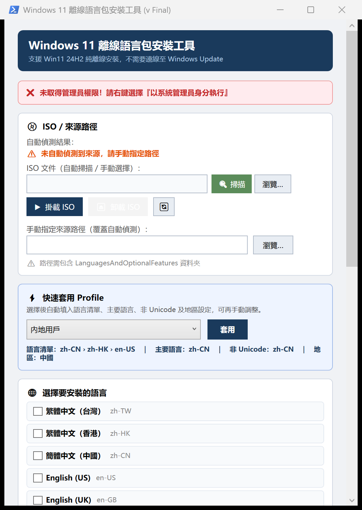

# Win11 Offline Language Pack Installer

A one-window PowerShell (WPF) tool that installs Windows 11 24H2 display languages **completely offline** - no
Windows Update, no Microsoft Store - and applies the regional settings in the right order. Built for PCs on
restricted networks where `Settings > Time & language` cannot download anything.



*The interface is in Traditional Chinese. The screenshot was taken without administrator rights, hence the red
banner; run the tool as administrator.*

## What it does

For each selected language it runs four steps, with a progress list and a live log:

| Step | How |
|---|---|
| 1. Base language pack (`.cab`) | `DISM /Add-Package` from the Languages and Optional Features ISO, skipped if already installed |
| 2. Modern UI pack (Local Experience Pack `.appx`) | `Add-AppxProvisionedPackage`; zh-HK uses the zh-TW LXP, as Windows does |
| 3. Features on Demand | `DISM /Add-Capability` for Basic, OCR, Handwriting, Speech, Text-to-Speech and the Hant / Hans fonts |
| 4. Settings (main language only) | Language list order, display language override, system locale (non-Unicode programs), home location (GeoId) and regional format |

Also:

- **ISO handling**: finds a `*CLIENT_LOF_PACKAGES*.iso` next to the script, mounts it with one click and unmounts
  it when the window closes; or point it to any folder that contains `LanguagesAndOptionalFeatures`.
- **Profiles**: one click fills in languages, main language and locale (e.g. *Hong Kong user*: zh-HK > zh-TW >
  en-US, locale zh-CN; *Mainland user*: zh-CN > zh-HK > en-US).
- **zh-HK input fix**: removes the Bopomofo (Zhuyin) keyboard that Windows adds for zh-HK and adds Quick (速成)
  instead (takes effect after signing out and in).
- **Pre-install check**: reports languages that are already installed (via DISM) before anything changes.
- Cancel button, restart button, copy log and export an installation report.

Supported languages: zh-TW, zh-HK, zh-CN, en-US, en-GB, ja-JP, ko-KR, fr-FR, de-DE, es-ES (add more in
`$langDefinitions` at the top of the script).

## Requirements

- Windows 11 24H2 (build 26100), run **as administrator**
- Windows PowerShell 5.1 (built in)
- The language media, which you must obtain from Microsoft through your own licensing channel (they are **not**
  included here):
  - *Languages and Optional Features* ISO for 24H2, e.g. `26100.1.240331-1435.ge_release_amd64fre_CLIENT_LOF_PACKAGES_OEM.iso`
  - Local Experience Pack files, e.g. `Microsoft.LanguageExperiencePackzh-TW_..._neutral__8wekyb3d8bbwe.Appx`

## Usage

1. Put `LangPack_Installer.ps1`, `run.bat`, the ISO and the `.appx` files in one folder.
2. Right-click `run.bat` > **Run as administrator**.
3. Click **掛載 ISO** (Mount ISO), or choose a source folder manually.
4. Pick a profile and click **套用** (Apply), or tick languages yourself and choose the main language and locale.
5. Click **開始安裝** (Start), wait for all steps, then restart.

## Build an EXE (optional)

```powershell
Install-Module ps2exe -Scope CurrentUser
.\Build_EXE.ps1        # creates LangPackInstaller.exe (requires admin when started); add app.ico to embed an icon
```

## Notes and limitations

- Tested on Windows 11 24H2 only; other builds need their own matching ISO.
- Settings from step 4 apply to the current user and the system; new user profiles may need
  *Copy settings to welcome screen and new user accounts* in the Region control panel.
- Changing the system locale and display language requires a restart.
- Test on one PC first; language changes are hard to undo cleanly.

## Licence

[MIT](LICENSE). Windows, the language packs and the Local Experience Packs are Microsoft products and are not part
of this project.
